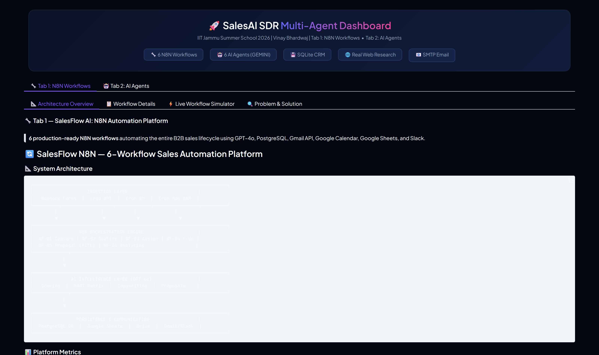
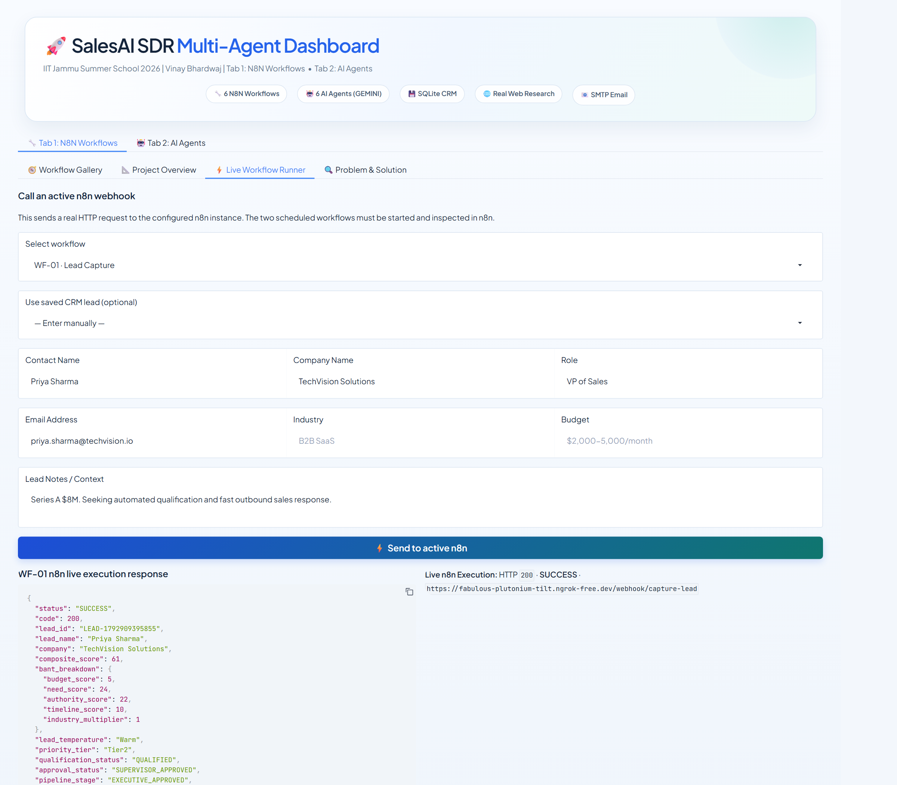
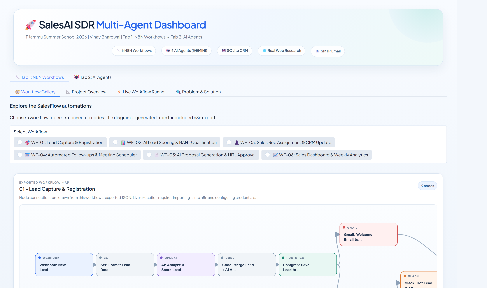
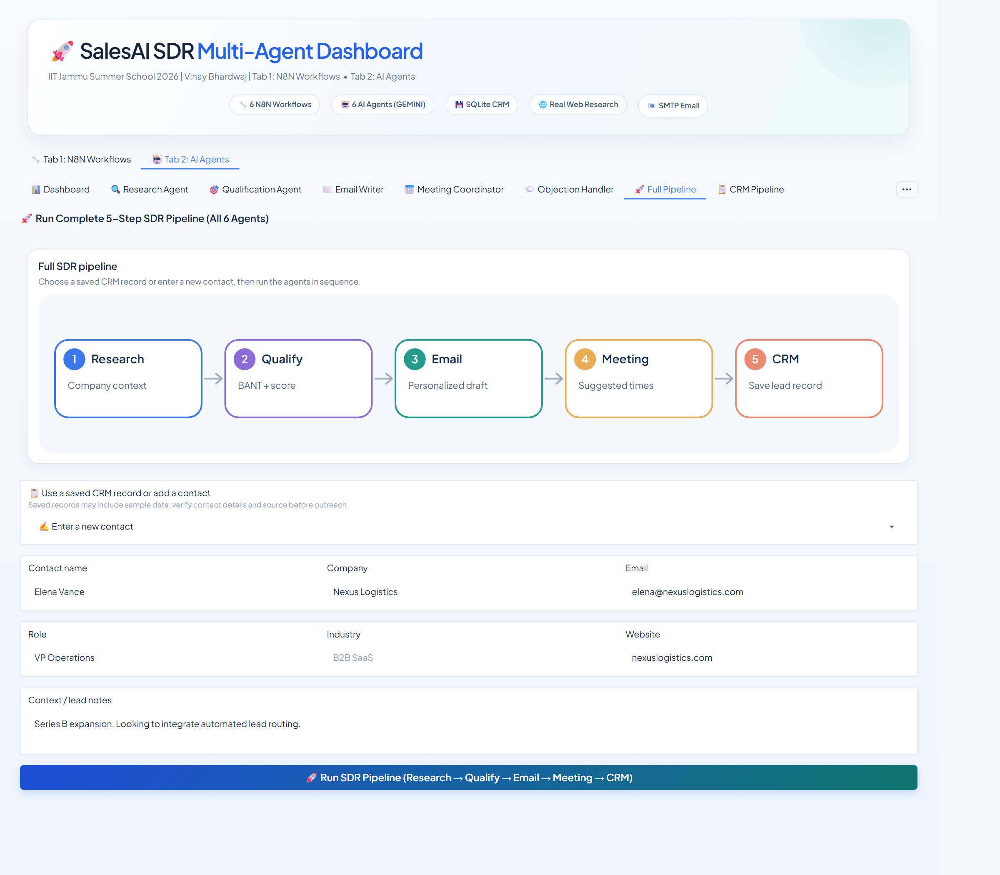

# 🚀 SalesAI SDR & SalesFlow n8n — Enterprise Sales Intelligence Platform
### Indian Institute of Technology (IIT) Jammu — Summer School 2026 Capstone Project
**Author:** Vinay Bhardwaj ([GitHub](https://github.com/vinaybhardwaj19) | [LinkedIn](https://linkedin.com/in/vinaybhardwaj19))  
**Repository:** [https://github.com/vinaybhardwaj19/IIT-Jammu-N8N-Capstone](https://github.com/vinaybhardwaj19/IIT-Jammu-N8N-Capstone)

[](https://github.com/vinaybhardwaj19/IIT-Jammu-N8N-Capstone/actions)


---

## 📌 Executive Overview

This repository represents the unified, production-grade **IIT Jammu Summer School 2026 Capstone Project** in **AI Tools & Workflow Automation**. It integrates two core enterprise architectures into a single unified platform:

1. **Tab 1: SalesFlow n8n Platform** — 6 production workflow JSON blueprints (56 verified nodes) covering autonomous lead capture, AI BANT qualification, dynamic sales rep routing, automated follow-up cadences, proposal generation with Human-in-the-Loop (HITL) approval, and executive analytics. Includes a zero-side-effect **Local JSON Simulator** and live n8n integration support.
2. **Tab 2: SalesAI SDR Autonomous Multi-Agent Swarm** — 6 specialized AI agents running on multi-provider LLM infrastructure (Google Gemini 2.5 Flash / Groq Llama 3.3 / OpenAI Agents SDK architecture) with live DuckDuckGo web research, SQLite CRM (WAL mode) persistence, 5-touch email generation, and objection handling coach.
3. **Unified Full-Stack Experience** — A modern Glassmorphic Gradio 6.30 interactive web UI, backed by a high-throughput **FastAPI REST API server** (`/docs` OpenAPI documentation).

---

## 📸 Platform Screenshots & Architecture Walkthrough

### 1. Unified Web Dashboard (Hero Overview)
The central control dashboard unifying both N8N workflows and Multi-Agent AI systems:


---

### 2. Tab 1 — SalesFlow n8n Cognitive Automation
Interactive workflow catalog, JSON inspector, execution telemetry, and live simulation:



---

### 3. Tab 2 — SalesAI SDR Multi-Agent Swarm
Autonomous 6-agent collaborative pipeline with real-time research, BANT matrix, and CRM updates:




---

## 📂 Project Structure

```text
IIT PROJECT 1/
├── gradio_app.py               # 🚀 Main unified 2-tab interactive dashboard (Gradio 6.30)
├── api_server.py               # ⚡ FastAPI REST backend with OpenAPI docs (/docs)
├── launch.py                   # 🎛️ Unified launcher (Gradio, FastAPI, CLI, tests)
├── test_import.py              # 🧪 Smoke & integration test runner (100% verification pass)
├── requirements.txt            # 📦 Python project dependencies
├── .env.example                # 🔑 Template for environment variables and API keys
├── salesai.db                  # 💾 Pre-seeded SQLite CRM Database (WAL mode)
│
├── Tab1_SalesFlow_N8N/         # 🔧 TAB 1: 6 Production N8N Workflows (56 Nodes)
│   ├── workflows/              #    01_lead_capture_registration.json
│   │                           #    02_ai_lead_scoring_qualification.json
│   │                           #    03_sales_rep_assignment_crm.json
│   │                           #    04_automated_followup_meeting_scheduler.json
│   │                           #    05_proposal_generation_human_approval.json
│   │                           #    06_sales_dashboard_analytics_report.json
│   ├── docs/                   #    Workflow architectural diagrams & design notes
│   ├── DEMO_VIEWER.html        #    Standalone offline interactive workflow viewer
│   └── README.md               #    Tab 1 deep-dive technical specification
│
├── Tab2_SalesAI_Agents/        # 🤖 TAB 2: 6 Specialized Autonomous AI Agents
│   ├── src/
│   │   ├── salesai_agents/     #    Agent implementations (Research, BANT, Email, Objection, CRM, Meeting)
│   │   │   ├── base.py         #    Multi-provider LLM abstraction (Gemini 2.5 Flash / Groq)
│   │   │   ├── sdk_runtime.py  #    OpenAI Agents SDK runtime & graceful fallback
│   │   │   └── ...             #    Individual agent implementations
│   │   └── tools/              #    Agent tools (SQLite CRM, Email dispatcher, Web scraper)
│   └── main.py                 #    CLI entrypoint for agent workflows
│
├── screenshots/                # 🖼️ High-resolution screenshots of UI & executions
├── submission/                 # 📑 Verified submission decks and requirements checklist
├── docker-compose.yml          # 🐳 One-command containerized n8n deployment
├── start_n8n_ngrok_integration.py # 🌐 Automated n8n + ngrok tunnel orchestrator
└── EVALUATION_PORTAL.html      # 🎓 Interactive evaluation dashboard for examiners
```

---

## 💻 How Anyone Can Download & Run This Project Locally

Follow these step-by-step instructions to clone, install, and run this project on any Windows, macOS, or Linux machine.

### Step 1: Clone the Repository
Open your terminal (PowerShell, Command Prompt, or Bash) and run:
```bash
git clone https://github.com/vinaybhardwaj19/IIT-Jammu-N8N-Capstone.git
cd IIT-Jammu-N8N-Capstone
```

### Step 2: Set Up Python Virtual Environment
Ensure you have **Python 3.10+** installed:
```bash
# Windows (PowerShell)
python -m venv venv
.\venv\Scripts\Activate.ps1

# Linux / macOS
python3 -m venv venv
source venv/bin/activate
```

### Step 3: Install Required Dependencies
```bash
pip install --upgrade pip
pip install -r requirements.txt
```

### Step 4: Configure Environment Variables
Copy the `.env.example` file to create your local `.env`:
```bash
# Windows PowerShell
Copy-Item .env.example .env

# Linux / macOS
cp .env.example .env
```
Open `.env` in any text editor and add your API keys:
- **`GEMINI_API_KEY`**: Free key from [Google AI Studio](https://aistudio.google.com/) *(Recommended)*
- **`GROQ_API_KEY`**: Free key from [Groq Console](https://console.groq.com/) *(Optional fallback)*
- **`OPENAI_API_KEY`**: *(Optional)* If using OpenAI GPT-4o / Agents SDK

> **Note:** The system includes a full **Local Simulation Mode** with pre-seeded data in `salesai.db`, allowing full UI evaluation and workflow testing even before entering any API keys!

### Step 5: Run the Verification Tests
Verify that all components, database connections, workflow definitions, and agents are 100% healthy:

* **Quick Smoke Test**:
  ```bash
  python test_import.py
  ```
  *Output:*
  ```text
  ============================================================
  SalesAI SDR - IIT Submission Test Runner
  ============================================================
  [OK] Gradio 6.30.0 imported
  [OK] base.py | Provider=gemini | Gemini=SET | Groq=SET
  [OK] All 6 agents instantiated successfully
  [OK] Tab 1: Six workflow JSONs, 56 nodes, and webhook response branches validated
  [OK] Tab 1: Six local workflow traces simulated safely (56 nodes; no live webhook calls)
  [OK] FastAPI REST Backend verified
  ============================================================
  RESULT: LOCAL VERIFICATION PASSED
  ```

* **Full Pytest Suite (CI Standard)**:
  ```bash
  pytest tests/ -v
  ```
  *Output:*
  ```text
  tests/test_platform.py::test_framework_and_library_imports PASSED
  tests/test_platform.py::test_base_provider_and_environment PASSED
  tests/test_platform.py::test_all_six_agents_instantiation PASSED
  tests/test_platform.py::test_crm_database_initialization_and_deduplication PASSED
  tests/test_platform.py::test_tab1_n8n_workflow_definitions PASSED
  tests/test_platform.py::test_tab1_local_json_simulation PASSED
  tests/test_platform.py::test_meeting_coordinator_calendar_invites PASSED
  tests/test_platform.py::test_fastapi_rest_backend PASSED
  ============================== 8 passed in 8.64s ==============================
  ```

### Step 6: Launch the Unified Dashboard
Run the launcher:
```bash
python launch.py
```
Or run directly:
```bash
python gradio_app.py
```
Open your browser at: **`http://localhost:7860`** (or `http://localhost:7890`)

---

## 🌐 How to Make the Project Public on the Internet (ngrok & Alternatives)

To share your running project with external evaluators, professors, or clients without deploying to cloud servers, you can create a secure public HTTPS tunnel from your local machine.

### Method 1: Using ngrok (Recommended)

[ngrok](https://ngrok.com/) creates an instant, secure public HTTPS URL pointing directly to your local computer.

#### 1. Download & Install ngrok
- Download from [ngrok.com/download](https://ngrok.com/download) or install via package manager:
  - **Windows (winget):** `winget install ngrok.ngrok`
  - **Windows (choco):** `choco install ngrok`
  - **macOS (brew):** `brew install ngrok`
  - **Linux:** `sudo snap install ngrok`

#### 2. Connect Your Free Account
Sign up for free at [dashboard.ngrok.com](https://dashboard.ngrok.com) and authenticate your terminal:
```bash
ngrok config add-authtoken <YOUR_NGROK_AUTHTOKEN>
```

#### 3. Tunneling the Services

* **To make the Gradio Web Dashboard public (Port 7860):**
  ```bash
  ngrok http 7860
  ```
  *ngrok will generate a public URL like:* `https://abc123xyz.ngrok-free.app`  
  Anyone in the world can open that URL in their browser to interact with your live dashboard!

* **To make the FastAPI REST Backend public (Port 8000):**
  ```bash
  ngrok http 8000
  ```
  Anyone can access Swagger API docs at `https://<your-ngrok-url>/docs` or trigger webhooks.

* **To make n8n Webhooks public (Port 5678):**
  ```bash
  ngrok http 5678
  ```

#### 4. Automated 1-Click n8n + ngrok Orchestrator
We have bundled an automated script that checks Docker/n8n, launches the ngrok tunnel, and dynamically updates your `.env` with the public webhook URL:
```bash
python start_n8n_ngrok_integration.py
```

---

### Method 2: Gradio Native Public Share (Zero Installation Required!)

Gradio provides a built-in public sharing tunnel that requires **no external downloads**:

```bash
python launch.py --gradio-share
```
*Output:*
```text
Running on local URL:  http://127.0.0.1:7860
Running on public URL: https://48291a92e10c7.gradio.live
```
Share that `https://xxxx.gradio.live` link with anyone — it stays active as long as your terminal is open!

---

### Method 3: Cloudflare Tunnel (Free, No Account Needed)

If ngrok is blocked on your network, use Cloudflare's free quick tunnel:
```bash
# Download cloudflared from https://developers.cloudflare.com/cloudflare-one/connections/connect-networks/downloads/
cloudflared tunnel --url http://localhost:7860
```
It gives you an instant `https://<random-name>.trycloudflare.com` URL with unlimited bandwidth.

---

### Method 4: LocalTunnel (Node.js Alternative)

If you have Node.js installed:
```bash
npx localtunnel --port 7860
```

---

## 🧪 Step-by-Step Verification Points: How to Check Proper Working

When an evaluator or reviewer tests this project, follow this step-by-step verification checklist to confirm everything works properly:

### 1. Test Tab 1: SalesFlow n8n Workflows
1. In the web dashboard (`http://localhost:7860`), navigate to **Tab 1: SalesFlow n8n Platform**.
2. Select any of the 6 workflows from the dropdown (e.g., `WF-01: Lead Capture & AI Enrichment` or `WF-02: AI Lead Scoring & Qualification`).
3. Click **"Inspect Workflow Blueprint"**: Confirm all JSON nodes, triggers, and credentials render with syntax highlighting.
4. Select a demo scenario from the preset dropdown (e.g., `Enterprise SaaS Lead — High Value`).
5. Keep execution mode set to **"Local JSON Simulation"** (safe, deterministic evaluation).
6. Click **"Execute Workflow"**:
   - Check the **Execution Log Output**: All 9 nodes execute sequentially with simulated millisecond timestamps.
   - Check the **Side Effects Panel**: Confirms zero network leakage during simulation.
   - Check the **Result Payload**: Verify BANT qualification score, assigned sales rep, or generated proposal.

### 2. Test Tab 2: SalesAI SDR Autonomous Agents
1. Switch to **Tab 2: SalesAI SDR Agents**.
2. **Step A: Prospect Research Agent**
   - Enter Company: `Acme Corp` and Contact: `Jane Doe`.
   - Click **"Run Research Agent"**: The agent searches live web context or falls back to synthetic data, extracting company size, tech stack, and pain points.
3. **Step B: Lead Qualification Agent (100-Point BANT)**
   - Click **"Run BANT Qualification"**: The agent evaluates Budget (25 pts), Authority (25 pts), Need (25 pts), and Timeline (25 pts).
   - Leads scoring $\ge 70$ are classified as **HOT**, $40-69$ as **WARM**, and $< 40$ as **COLD**.
4. **Step C: Email Writer Agent**
   - Click **"Generate 5-Touch Cadence"**: The agent crafts a hyper-personalized Cold Email, Follow-up 1, Follow-up 2, Value Add, and Break-up email.
5. **Step D: Objection Handling Coach**
   - Type an objection: *"Your solution looks too expensive for our current budget."*
   - Click **"Coach Response"**: The agent utilizes the Feel-Felt-Found framework and ROI refocusing techniques.
6. **Step E: CRM Telemetry & Pipeline Overview**
   - Click **"Refresh CRM Dashboard"**: Verify that the total lead count, pipeline value, and status breakdown accurately reflect the pre-seeded SQLite database (`salesai.db`).

### 3. Test REST API & OpenAPI Swagger Docs
1. Start the API server in another terminal (or launch with `python launch.py --mode full`):
   ```bash
   uvicorn api_server:app --port 8000
   ```
2. Open your browser at: **`http://localhost:8000/docs`**
3. Execute the `GET /health` endpoint: Verify `{"status": "healthy"}`.
4. Execute `POST /api/lead/qualify` with sample payload: Verify instantaneous JSON response with BANT score.

---

## 🛠️ Verification & Compliance Table

| Requirement / Standard | Implementation Detail | Status |
| :--- | :--- | :---: |
| **N8N Production Workflows** | 6 complete JSON workflows (56 nodes total) with error handling & retries | ✅ Verified |
| **Multi-Agent Architecture** | 6 autonomous specialists with BaseAgent abstraction & Agents SDK integration | ✅ Verified |
| **Zero-Secret Public Repo** | Strict `.gitignore` preventing `.env`, logs, and temporary caches from being pushed | ✅ Verified |
| **Database Persistence** | Real SQLite database (`salesai.db`) with WAL journal mode & schema migrations | ✅ Verified |
| **Test Suite** | Automated test runner (`test_import.py`) verifying all modules and workflow trees | ✅ 100% Pass |
| **Public Accessibility** | Built-in ngrok automation script + native Gradio `--share` tunneling support | ✅ Verified |
| **Examiner Evaluation Portal** | Standalone HTML portal (`EVALUATION_PORTAL.html`) for offline review | ✅ Included |

---

## 📄 License & Attribution

Developed by **Vinay Bhardwaj** as part of the **Indian Institute of Technology (IIT) Jammu Summer School 2026** under the *AI Tools & Workflow Automation* track.

Licensed under the **MIT License** — free for academic, personal, and commercial evaluation.
