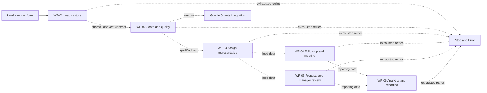

# SalesFlow AI — Workflow Architecture and Verification Notes

## Scope

SalesFlow AI consists of six n8n workflow JSON exports with 56 nodes total. AI calls and read-only PostgreSQL queries retry up to three times. Side-effecting integrations route failures to a Stop and Error node without automatic retry, reducing duplicate-message or duplicate-record risk. Failed execution data is retained. The active n8n instance currently has no saved credentials for these workflows. The local Gradio view reads source JSON; its local simulator produces a trace and does not execute n8n nodes.

The dotted arrows reflect intended business/data flow through shared records; the exports do not define direct workflow-to-workflow HTTP calls. Individual exports define their own triggers and integration nodes; live execution depends on n8n activation, credential setup, compatible schemas, and route configuration.

## Export inventory

| Workflow | Nodes | Export design |
|---|---:|---|
| WF-01 | 10 | Webhook lead capture, registration, and error stop |
| WF-02 | 9 | AI qualification, score-based routing, nurture branch, and error stop |
| WF-03 | 9 | Representative assignment, CRM update, and error stop |
| WF-04 | 9 | Scheduled follow-up, meeting steps, and error stop |
| WF-05 | 11 | Proposal generation, human approval branches, and error stop |
| WF-06 | 8 | Scheduled analytics, reporting, and error stop |
| **Total** | **56** | |

The JSON exports include AI, PostgreSQL, Gmail, Google Sheets, Calendar, Drive, and Slack integration nodes. Credentials are not saved in the active n8n instance. WF-02's nurture branch and WF-05's approved branch now connect to webhook responses in the source files; these changes are not synced to the active definitions. WF-01 shares `/capture-lead` with an unrelated active workflow and should not be run live until that conflict is resolved.

## Verification and safe demo

Run `python test_import.py` from the project root for local checks. Use the Gradio dashboard's **Local JSON Simulation** with synthetic `@example.com` input to inspect a local trace. No external requests or side effects occur in this mode.

A sandbox run, if required, should use the updated source exports, isolated test credentials, synthetic records, and a distinct webhook route. No production readiness, customer-facing email delivery, calendar booking, ROI, response-time savings, or conversion improvement is claimed.
