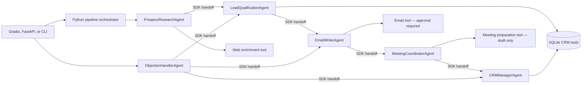

# SalesAI SDR — OpenAI Agents SDK Architecture

**Course:** IIT Jammu Summer School 2026 — AI Sales Development Representative  
**Candidate:** Vinay Bhardwaj

## Scope

Six SDK `Agent` objects are defined by the official OpenAI Agents SDK and invoked through `Runner`. `AgentTextOutput` is a Pydantic output schema. The legacy specialist classes keep their `run(dict) -> dict` interface for the existing Gradio and FastAPI callers; inside those adapters, each task's JSON body remains a JSON string validated inside the Pydantic response envelope.

## Handoff graph

The Python pipeline still calls stage adapters in a predictable order. SDK handoffs are declared between specialists for the Runner to use when a task requires delegation. This design does not assert that every run will hand off; the model chooses whether delegation is needed.

## Agents and tools

- `ProspectResearchAgent`: uses the web enrichment tool for prospect/company context.
- `LeadQualificationAgent`: BANT/ICP analysis and CRM lookup.
- `EmailWriterAgent`: creates outreach drafts; sending is behind an SDK tool configured with `needs_approval=True`.
- `MeetingCoordinatorAgent`: generates meeting materials; the meeting tool returns a draft and explicitly does not book a calendar event.
- `ObjectionHandlerAgent`: objection coaching and roleplay; can delegate to qualification, email, or CRM specialists.
- `CRMManagerAgent`: SQLite lead lookup and upsert.

The API/UI send option remains off by default and requires an explicit `send_email` flag/checkbox. No email is sent by the local JSON simulator. Calendar booking is not configured.

## Persistence and integrity

The CRM uses SQLite in `salesai.db`. `get_connection()` now enables `PRAGMA foreign_keys=ON` for every connection. This enforces declared relationships for new writes; this change does not retroactively repair orphan rows already in a database file.

## Runtime configuration

The six agents use the OpenAI Agents SDK and `OPENAI_AGENT_MODEL` (default: `gpt-4.1-mini`). Configure `OPENAI_API_KEY` before using model-backed features. Gemini/Groq code remains in the compatibility `call_ai()` helper but is not the model runtime for the six capstone agents.

## n8n workflow fault handling

All six n8n workflow exports remain separate. AI calls and read-only PostgreSQL queries have three attempts with a one-second wait. Side-effecting nodes route their error output to a Stop and Error node without retrying. Failed execution data is retained by workflow settings. The exports still require valid credentials and sandbox execution before any live integration claim.

## Known limits

- A handoff is model-selected, so it is not guaranteed on every run.
- The typed SDK boundary validates the Pydantic response envelope; the specialist JSON body remains parsed by the existing adapter code.
- The local CRM is SQLite; external CRM sync is not configured.
- Meetings are drafts until a calendar provider is configured.
- The SDK email tool pauses for approval; its resumable SDK run state is held in the raised `AgentApprovalRequired` exception and is currently in-process.
- Live provider, SMTP, calendar, and n8n execution have not been tested as part of this code change.
